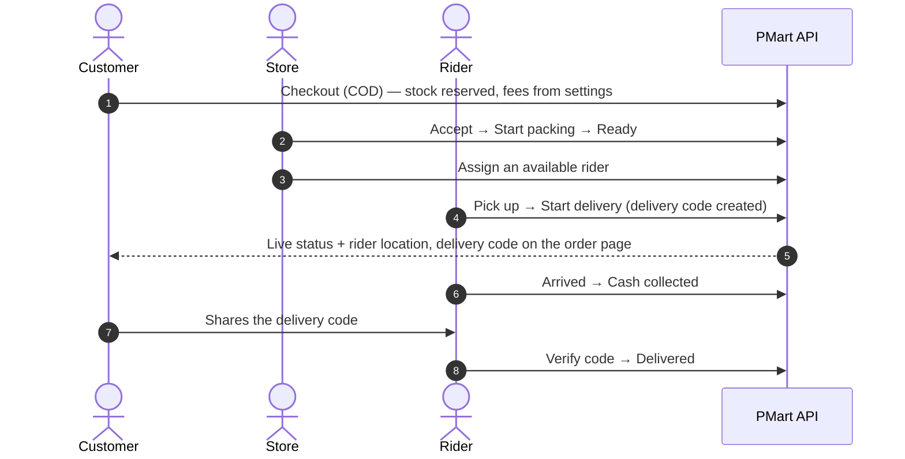

# PMart — Quick-Commerce Grocery Platform

PMart delivers groceries from nearby darkstores. One Node/Express + MongoDB backend serves four web portals:

| Portal | Path | Who |
|---|---|---|
| Storefront | `/` | Customers: browse, cart, cash-on-delivery checkout, live tracking, order history |
| Store portal | `/shop` | Store owners: accept → pack → ready → assign rider, products, analytics, store hours |
| Rider app | `/rider` | Riders: go online, pick up, deliver, collect cash, confirm with the customer's delivery code |
| Admin console | `/admin` | Admins and staff (permission-based): stores, catalog, people, orders, live deliveries, payments, reports, settings |

The database starts **empty** — there is no demo or seed data. Everything is created through the admin console.

## Quick start
Requirements: Node.js 20+, a MongoDB **replica set** (MongoDB Atlas works; transactions are required).

```bash
# 1. Backend
cd backend
npm install
# create backend/.env — see docs/PMart_ENVIRONMENT_REFERENCE.md (MONGODB_URI, JWT_SECRET, OTP_ENCRYPTION_KEY)
npm run db:init                                            # collections, indexes, default settings
npm run create-admin -- --name "Your Name" --phone 98XXXXXXXX   # first admin (asks for a password)
npm run dev                                                # API on PORT (default 5000)

# 2. Web app (project root, in another terminal)
npm install
npm run dev                                                # http://localhost:5173
```

If the API is not on port 5000, start the web app with `PMART_API_TARGET=http://localhost:<port> npm run dev`.
Sign in with the admin account, then add a store (this creates the store owner's login), categories, products and riders.

Maps and address search need `VITE_MAPTILER_API_KEY` in the root `.env`. Google sign-in is optional and needs Firebase
settings on both the web app and the backend.

## Commands
| Where | Command | What it does |
|---|---|---|
| root | `npm run dev` / `npm run build` / `npm run lint` | Vite dev server / production build / oxlint |
| backend | `npm run dev` / `npm start` | API with nodemon / without |
| backend | `npm test` | 80 Jest tests against an in-memory MongoDB replica set |
| backend | `npm run db:init` | Create collections, sync indexes, create settings (safe to re-run) |
| backend | `npm run create-admin` | Create the first administrator (`--force` adds another when one already exists) |

## How an order flows

Customers can cancel before packing starts; stores can reject with a reason; a rider can report "could not deliver"
and the store sends the order out again. Cancelled and rejected orders return their stock exactly once.

## Project layout
```
src/            React 19 + Vite web app (components, context, pages per portal, services, styles, types)
backend/src/    Express 5 API (config, middleware, modules/*, scripts, utils)
backend/tests/  Jest suites
docs/           Architecture, database, API, environment, status and remaining work
```

## Documentation
Start with [docs/PMart_HANDOVER_INDEX.md](docs/PMart_HANDOVER_INDEX.md). Deploying: [docs/PMart_DEPLOYMENT.md](docs/PMart_DEPLOYMENT.md) (Render + Vercel). Project rules for contributors are in
[AGENTS.md](AGENTS.md); design decisions in [DECISIONS.md](DECISIONS.md).

## License
Private & proprietary. All rights reserved by PMart.
