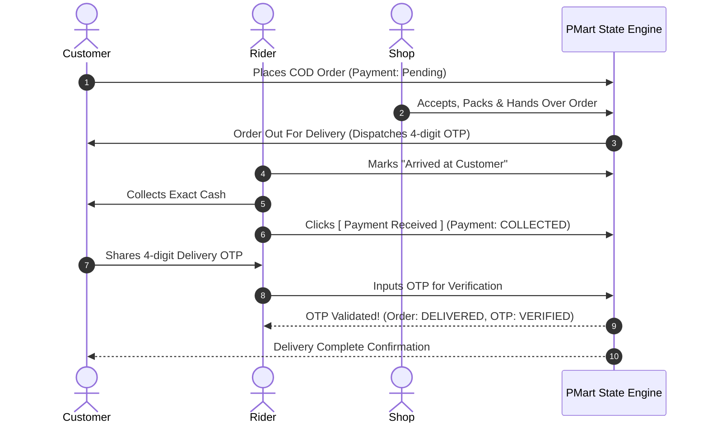

# PMart — Quick-Commerce Grocery Platform

A modern, high-performance quick-commerce grocery delivery platform built with **React 19**, **Vite**, and modular **SCSS**. PMart delivers an end-to-end multi-portal experience covering Customers, Delivery Riders, Darkstore/Shop Owners, and Admins.

---

## 🚀 Key Features & Portals

### 1. 🛒 Customer Experience
- **Superfast Catalog & Discovery**: Curated categories (Fresh Produce, Dairy & Breakfast, Pantry, Household), instant search with trending keywords, and responsive carousels.
- **Cart & COD-Only Checkout**: Frictionless checkout tailored exclusively for Cash on Delivery (COD) workflows.
- **Live Order Tracking**: Real-time 7-stage order progression timeline, delivery partner details, customer delivery OTP display, and interactive item breakdown dropdown.
- **Order History & Management**: Clean order cards with color-coded status badges, payment indicators, one-click `[View Order]` details, and quick `[Reorder]`.
- **Profile & Account Details**: Seamless drill-down account settings, saved addresses, and contact preferences.

### 2. 🛵 Delivery Rider App (`/rider`)
- **Active Task Stream**: Real-time list of assigned deliveries with route and customer information.
- **Step-by-Step Delivery Execution Flow**:
  1. **Arrival**: `[ Arrived at Customer ]` timestamp notification.
  2. **Cash Collection**: Dedicated cash-on-delivery collection prompt displaying exact non-editable order total with `[ Payment Received ]` confirmation.
  3. **OTP Verification**: Secure 4-digit delivery PIN verification with cooldown retry safeguards (OTP is never leaked in the rider UI).
  4. **Completion**: Immediate handover confirmation and earnings credit.

### 3. 🏬 Shop Owner / Darkstore App (`/shop`)
- **Live Order Fulfillment**: Inbound order notifications with status tracking (`Pending` $\to$ `Accepted` $\to$ `Packed` $\to$ `Handed Over to Rider`).
- **Audit & Governance**: Independent visibility into Order Status, Payment Status (`Pending` / `Collected`), and Delivery Verification (`OTP Pending` / `Verified`).
- **Failsafe Controls**: Enforces strict verification boundaries preventing unauthorized manual delivery overrides prior to OTP clearance.

### 4. 📊 Admin Control Tower (`/admin`)
- **Live Deliveries Monitor**: Real-time polling monitoring active rider locations, SLA adherence, and order statuses.
- **Financial Reconciliation**: Live metrics tracking collected cash vs pending COD orders across darkstores.

---

## 🛠️ Tech Stack

- **Frontend Framework**: [React 19](https://react.dev/)
- **Bundler & Tooling**: [Vite 8](https://vite.dev/)
- **Routing**: [React Router v7](https://reactrouter.com/)
- **Styling**: Vanilla SCSS architecture with curated design tokens, mixins, and responsive breakpoints
- **Animations**: [Framer Motion](https://www.framer.com/motion/)
- **Icons**: [Lucide React](https://lucide.dev/)
- **Linter**: [Oxlint](https://oxc.rs/)

---

## 📁 Project Architecture

```
Pmart/
├── public/                 # Static assets (favicons, logos, hero artwork)
├── src/
│   ├── assets/             # Bundled images & visual assets
│   ├── components/
│   │   ├── common/         # Header, Footer, BottomNavigation, CustomerLayout
│   │   ├── delivery/       # CollectPaymentSection, DeliveryVerificationSection
│   │   ├── order/          # OrderStatusTimeline, PaymentStatusBadge
│   │   ├── product/        # ProductCard, ProductCarousel, CategoryPill
│   │   └── ui/             # Modals, Drawers, Badges, Buttons
│   ├── context/            # Global CartContext, AuthContext, ToastContext
│   ├── data/               # Mock products, categories, stores, and test orders
│   ├── pages/
│   │   ├── admin/          # Admin Dashboard, Live Deliveries, Orders
│   │   ├── auth/           # Login, Register, OTP verification
│   │   ├── customer/       # HomePage, Search, Category, Product, Checkout, Tracking, Orders, Profile
│   │   ├── rider/          # Rider Dashboard, Active Orders, Delivery Execution Flow
│   │   └── shop/           # Shop Orders, Catalog, Fulfillment Details
│   ├── services/           # orderService, paymentService, deliveryOtpService, productService
│   ├── styles/             # _variables.scss, _mixins.scss, _breakpoints.scss, global styles
│   └── types/              # Canonical orderTypes (ORDER_STATUS, PAYMENT_STATUS, etc.)
├── package.json
└── vite.config.js
```

---

## 🚦 Getting Started

### Prerequisites
- [Node.js](https://nodejs.org/) (v18 or higher recommended)
- `npm` or `pnpm`

### Installation
```bash
# Clone the repository
git clone <repository-url>
cd Pmart

# Install dependencies
npm install
```

### Development Server
```bash
# Start Vite development server
npm run dev
```
The application will launch at `http://localhost:5173/` (or next available port).

### Production Build
```bash
# Build optimized production bundle
npm run build

# Preview production build locally
npm run preview
```

### Code Quality
```bash
# Run Oxlint
npm run lint
```

---

## 🔐 Cash on Delivery (COD) Flow Specifications



---

## 📄 License
Private & Proprietary. All rights reserved by PMart.
